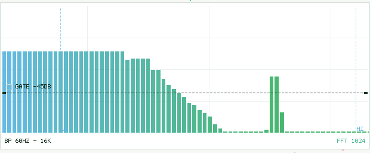
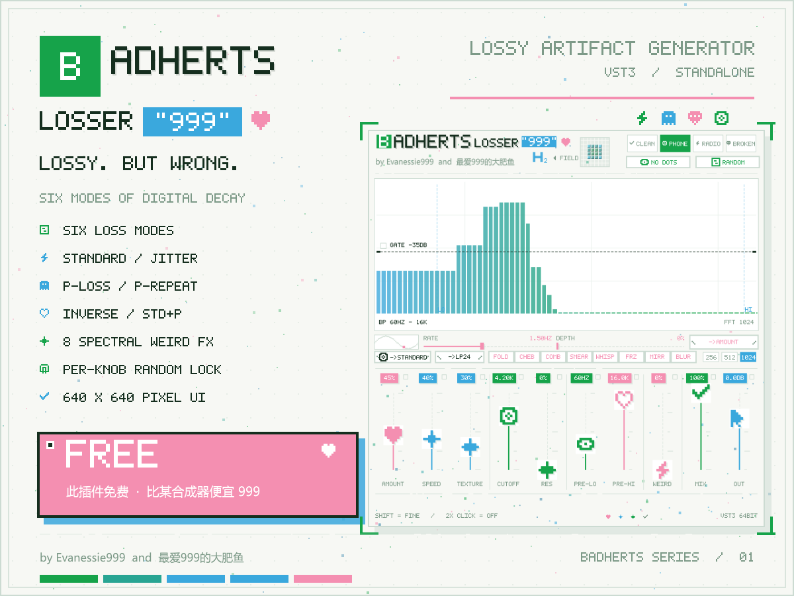

# BADHERTS Losser999

一个手写的 **VST3 / Standalone** 数字劣化插件：它不跑真正的编解码器，而是用极少的 DSP 手段，
把「低码率压缩、时钟抖动、网络丢包」这些有损音频的听感特征做出来，并配一套 640×640 的纯像素界面。


## Live demo





- **免费、开源**（MIT）
- JUCE 7 + CMake，无任何运行时依赖
- 全部界面元素都是代码画的：内置 5×7 点阵字库 + 一套 7×7 图标，没有字体文件、没有抗锯齿

---

## 六种劣化模式

同一个 `LOSS MODE` 选择器，同一组旋钮，在不同模式下重新解释自己的含义：

| 模式 | 做什么 | 旋钮含义 |
|---|---|---|
| **STANDARD** | 900 Hz 分两段，随机增益抖动 + 10 ms 音高漂移 | AMOUNT=抖动深度，SPEED=抖动速率 |
| **JITTER** | 1–3.5 采样分数延迟，快速 LFO 扫动 | AMOUNT=深度，SPEED=LFO 频率 |
| **P.LOSS** | 随机门控，空隙内静音 | AMOUNT=丢包频率，SPEED=空隙长度 |
| **P.REPEAT** | 同样的门控，但空隙内循环上一段 | 同上 |
| **INVERSE** | 输出 `preFiltered − 标准劣化`，即被丢弃的残差 | AMOUNT=残差比例 |
| **STD+P** | 标准劣化 + 丢包同时工作 | 丢包与重复各占一半 |

`PRE-LO` / `PRE-HI` 是前置带通，先把输入限带再劣化 —— 这是让声音"像电话 / 像烂 MP3"最有效的一步。
两端可以自由拖动，但永远不会交叉（至少差 1.2 倍）。

## 八个频谱 / 失真效果（可叠加）

`FOLD` 三角波折叠 · `CHEB` 切比雪夫整形 · `COMB` 反馈梳状 · `SMEAR` 频谱横向涂抹 ·
`WHISP` 相位随机化 · `FRZ` 频谱冻结 · `MIRR` 频谱镜像 · `BLUR` 跨帧时间涂抹

共用一个 `WEIRD` 量控制强度，全部跑在固定延迟的 STFT 上（256 / 512 / 1024 可选）。

## 其它控件

| 控件 | 说明 |
|---|---|
| **LFO** | 可指向任意参数（AMOUNT/SPEED/TEXTURE/CUTOFF/PRE-LO/PRE-HI/WEIRD/GATE/MIX/OUT/FIELD/RES） |
| **H₂** | 声场控制：0% 单声道 → 100% 原样 → 200% 超宽，并带高频联合立体声塌陷 |
| **FILTER** | 后置滤波器：OFF / LP12 / LP24 / HP12 / HP24 / BP / NOTCH，配 CUTOFF 与 RES 两个旋钮 |
| **GATE** | 频谱门限，画在那条可拖动的横线上，支持反向 |
| **NO DOTS** | 一键关掉界面里所有噪点 |
| **RANDOM** | 随机化除 MIX / OUT 外的所有参数；每个旋钮右上角的锁点可以锁定它 |
| **CLEAN / PHONE / RADIO / BROKEN** | 四种"机器性格"，同时改变带宽、底噪和界面配色 |

## 信号链

```
in → 前置带通 → 参数映射层 → 劣化引擎 → 后置滤波 → 效果总线 → 干湿混合 → 声场 → 安全限幅 → out
     HP/LP        lmode 决定      六种模式共享      8 个开关     MIX       H₂      软膝
```

延迟恒定为 1023 采样（与 FFT 大小无关），宿主延迟补偿不会跳。

---

## 构建

需要：

- **CMake 3.22+**
- **JUCE 7.0.12**（放在 `third_party/JUCE/`，不要用 JUCE 8/9：它们不支持 MinGW）
- Windows：**MinGW-w64 GCC 11+**（测试用的是 portable w64devkit），MSVC 也可以
- Linux / macOS：系统编译器

```bash
git clone https://github.com/juce-framework/JUCE.git third_party/JUCE
git -C third_party/JUCE checkout 7.0.12

cmake -S . -B build -G "MinGW Makefiles" -DCMAKE_BUILD_TYPE=Release \
      -DCMAKE_CXX_FLAGS="-include cstring -include cstdint -include cstdio -include cstdlib"
cmake --build build -j 8
```

产物在 `build/BadHertsLooser999_artefacts/Release/`，装插件：

```powershell
powershell -ExecutionPolicy Bypass -File tools\install.ps1
```

### 离线自检

```bash
./tools/audiotest_bitrot.exe
```

跑六种模式、八个效果和随机器，输出电平与稳定性检查。

## 工程结构

```
src/             处理器 + 编辑器 + DSP
src/pixel/       点阵字库、图标、控件、频谱、矩阵
tools/           构建脚本、离线测试、截图 / 海报生成
prompts/         CoT 模板与实时安全规则（CAN / SHOULD / MUST NOT）
docs/            设计说明与截图
plugin.json      插件清单（参数表、DSP 声明、UI token）
```

同仓库里还有第二个小插件 **TapeGrain**（磁带饱和 / 降位深 / 抖晃 / 噪声），共用同一套构建。

## 实时安全

- `processBlock` 内不分配内存、不加锁、不调用系统随机数
- 所有缓冲区在 `prepareToPlay` 里一次性分配
- 滤波器系数只在参数变化时重算，采样循环里没有 `sin` / `exp` / `pow`
- 不实现任何真实的熵编码 / 心理声学模型 / 比特流 —— 全部是参数化伪影

## 许可

MIT，见 [LICENSE](LICENSE)。

作者：**Evanessie999 and 最爱999的大肥鱼**
